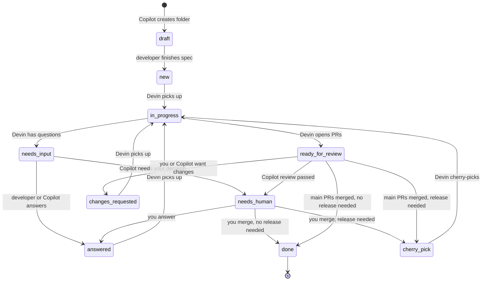

# cooragent

A simple async loop between GitHub Copilot and Devin. You write feature requests with Copilot, and an hourly scheduled Devin session implements them across your repos. An optional GitHub Action lets Copilot answer Devin's questions and review its PRs with no chat prompt.

- **This repo** holds only requests and communication, never code. It is **main-only**: you, Copilot and Devin all commit and push straight to `main`. No branches or PRs here.
- **Target repos** are where Devin makes the actual changes, always on a feature branch with a PR. It never pushes to their `main`.
- **Cadence:** Devin runs once an hour (the platform minimum). No trigger on push.

## Folder structure

```
cooragent/
  .github/
    copilot-instructions.md        # chat Copilot: how to write specs
    copilot-autopilot.md           # automated Copilot: answer and review
    workflows/copilot-autopilot.yml
  devin/
    hourly-session-prompt.md       # paste into the scheduled Devin session
  templates/
    feature.md                     # spec template
  features/
    <feature-id>-<short-name>/
      feature.md     # spec, written by the developer only
      questions.md   # Devin asks, the developer (or Copilot) answers
      results.md     # written by Devin only
      status.md      # one line: the current state
```

## Status values

| Status | Set by | Meaning |
| --- | --- | --- |
| `draft` | Copilot (on creation) | Spec is still being written; Devin ignores it |
| `new` | Developer | Spec is complete and ready for Devin |
| `in-progress` | Devin | Devin is working on it this session |
| `needs-input` | Devin | Questions are waiting in questions.md |
| `answered` | Developer or Copilot | All questions answered; Devin can continue |
| `ready-for-review` | Devin | PRs are open; the developer (or Copilot) reviews |
| `changes-requested` | Developer or Copilot | Feedback is in questions.md or on the PR; Devin should revise |
| `needs-human` | Copilot (automated mode) | Copilot needs your decision, or its review passed and you should test and merge; Devin skips it |
| `cherry-pick` | Developer | Main PRs are merged and verified; Devin should cherry-pick to the release branch |
| `done` | Developer | All PRs merged (including any release PR); Devin never touches this folder again |



Devin acts only on `new`, `answered`, `changes-requested` and `cherry-pick`. Everything else, including `draft` and `needs-human`, is skipped, so a half-written folder pushed by accident is never picked up.

## Setup

### 1. Copilot (chat)

`.github/copilot-instructions.md` is picked up automatically when you use Copilot in this repo. Ask it to create a feature; it interviews you and creates the folder from `templates/feature.md`.

### 2. Devin (hourly)

1. Give the Devin session access to this repo and every target repo.
2. Create a scheduled session that runs every hour, with `devin/hourly-session-prompt.md` as its prompt (or save it as a Devin Playbook and point the schedule at it).
3. Run it manually once before turning the schedule on.

### 3. Optional: automated Copilot (no chat)

When Devin pushes `needs-input` or `ready-for-review` for a feature with `Auto: on`, the Action runs Copilot CLI headless. It answers what follows from the spec or code and sets `answered`, or reviews the PRs and sets `changes-requested`. Anything that needs you becomes `needs-human` and opens an issue assigned to you. After 3 automated rounds on one feature, Copilot stops and hands it to you. Copilot never merges and never sets `new`, `cherry-pick` or `done`.

1. Create a fine-grained personal access token with the **Copilot Requests** permission and save it as the repo secret `COPILOT_PAT`.
2. Create a second token with read access to contents and PRs in the target repos and write access to PR reviews, and save it as `TARGET_REPOS_PAT`.
3. Check the assignee in `.github/workflows/copilot-autopilot.yml` (set to `ssakoora`).
4. Set `Auto: on` on one low-risk feature and watch one full round before using it more widely.

When you handle a `needs-human` feature, answer or test as usual, set the status yourself (`answered`, `changes-requested`, `cherry-pick` or `done`), push, and close the issue.

## Pilot checklist

1. Add the secrets (if using automated mode).
2. Write one small, low-risk test feature with Copilot.
3. Run the Devin session manually once.
4. Run one full question-and-answer round, then one full review round.
5. Tweak the instructions, then turn on the hourly schedule.

## Later: one session per feature

If you have Devin API access, the hourly session can become a dispatcher: it finds the work, sets each feature to `in-progress`, and starts a separate Devin session per feature through the API, with the API key stored as a Devin secret. That gives each feature a clean context and removes the 45-minute limit. Check your plan's limit on sessions running at the same time.
